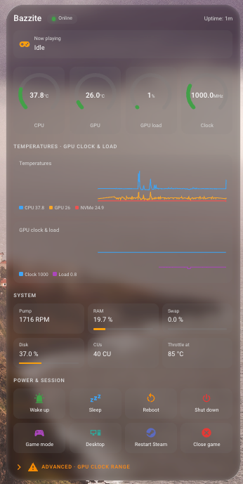
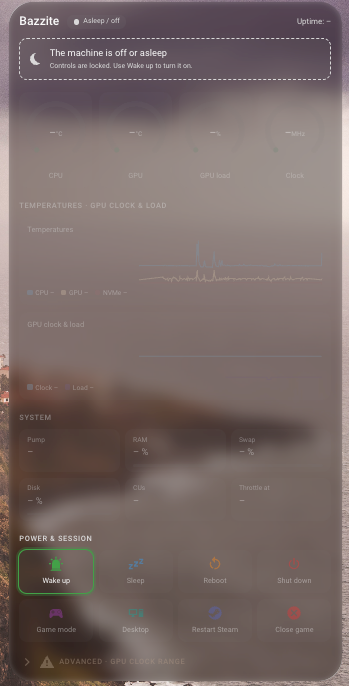
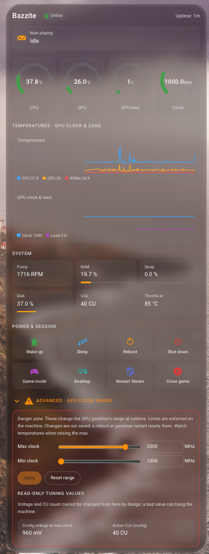
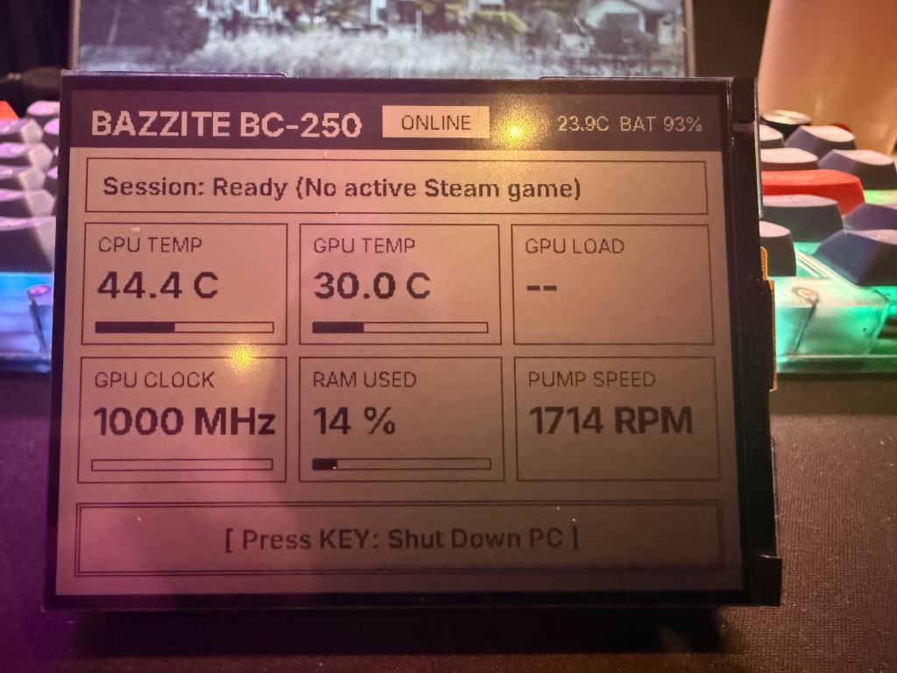
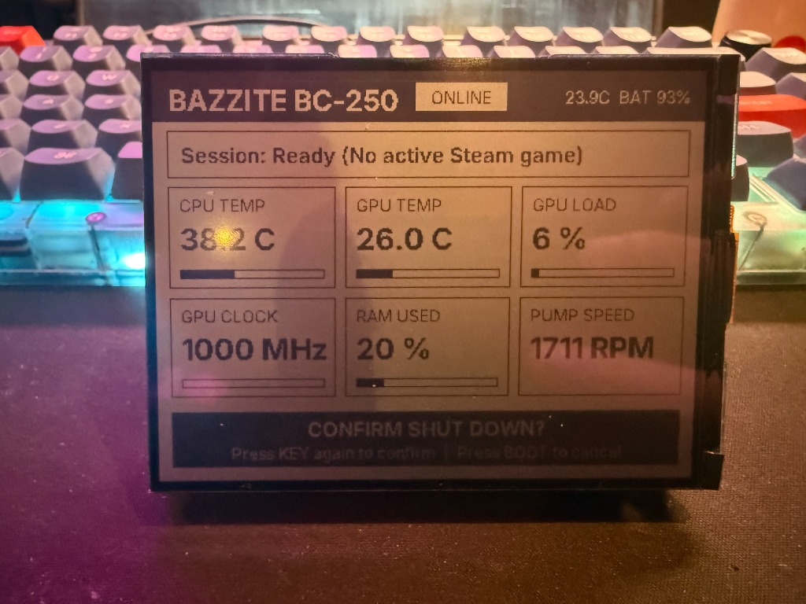
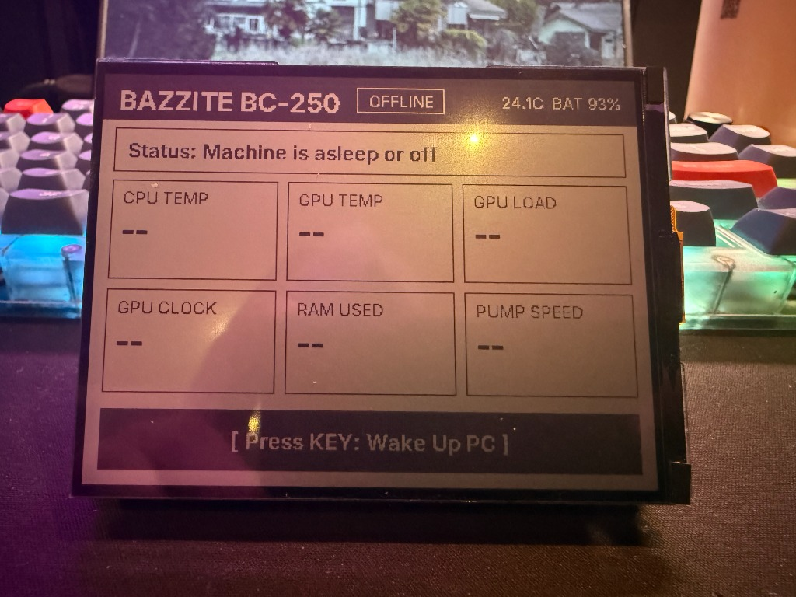
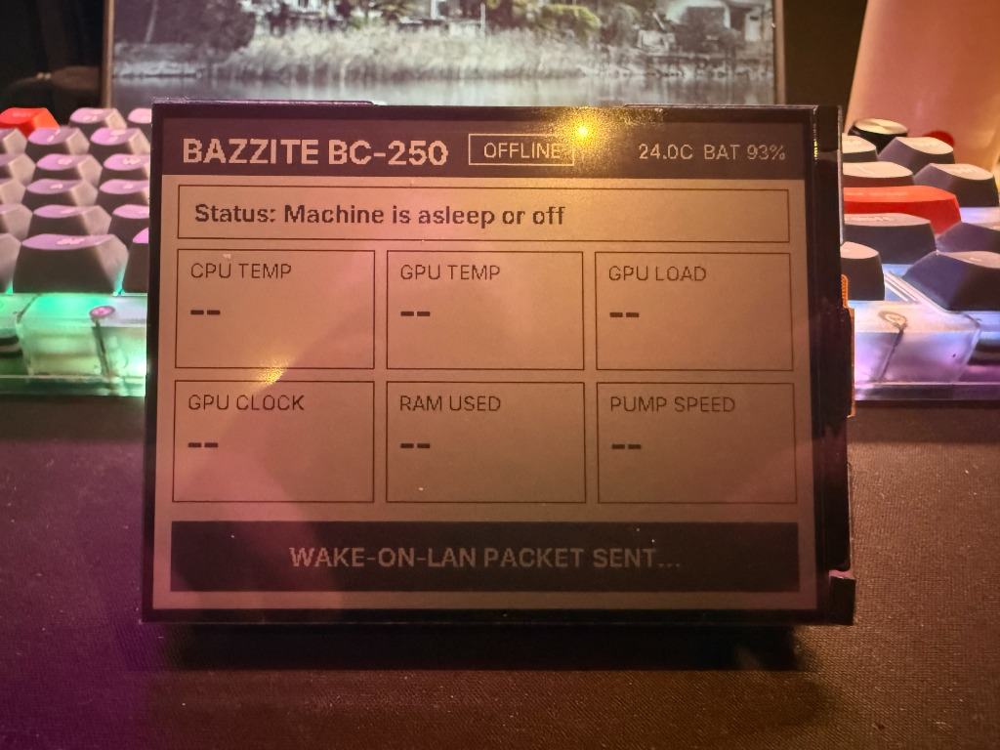

# bc250-ha-bridge

Expose an AMD **BC-250** gaming PC (Cyan Skillfish, running Bazzite or another Linux with the
`cyan-skillfish-governor-smu` GPU governor) to **Home Assistant** over **MQTT**,
with sensors, a few controls, and a ready-made dashboard.

One small Python script, standard library only. No `pip`, no containers, nothing installed
system-wide besides a systemd unit (and optionally a polkit rule).

> Built for one specific, heavily modified board. Read **Safety** before enabling the
> Advanced controls.

The `bc250-card` custom card, as it looks in Home Assistant.

| Online | Machine off or asleep | Advanced panel open |
|---|---|---|
|  |  |  |

When the machine is off, everything is locked except **Wake up**. Destructive buttons ask for
confirmation, and the GPU clock panel is collapsed unless `show_advanced: true`.

The background photo and the frosted-glass theme in these screenshots are personal choices and
are not part of this repo (the card itself has a `glass: true` option for a similar look).

## What you get

**Sensors** (HA MQTT discovery, published every 30 s): CPU / GPU / NVMe temperature, GPU clock,
GPU load, pump RPM, RAM / swap / disk use, uptime, current Steam game, active CU count (from the
CU manager config), configured voltage at the current max clock, governor throttle temperature,
current GPU min/max range.

**Controls**: Sleep, Reboot, Shut down, Restart Steam, Switch to Desktop / Game mode,
Close current game, and an **[Advanced]** GPU min/max clock range with a Reset button.

**Availability**: the device shows *unavailable* in HA when the machine is asleep or off (MQTT
last-will). Wake it with HA's *Wake on LAN* integration (see below).

## Requirements

- An MQTT broker reachable from the PC (for example the Mosquitto add-on in Home Assistant)
  and an MQTT user for the bridge.
- Python 3.11+ (`tomllib`) and `systemd`.
- Optional: `cyan-skillfish-governor-smu` for the GPU clock features. Without it those entities
  report nothing.

## Install

```bash
git clone https://github.com/phiiaz/bc250-ha-bridge ~/bc250-ha-bridge

# 1. credentials (never commit the real file)
mkdir -p ~/.config/bc250-ha-bridge
cp ~/bc250-ha-bridge/env.example ~/.config/bc250-ha-bridge/env
chmod 600 ~/.config/bc250-ha-bridge/env && $EDITOR ~/.config/bc250-ha-bridge/env

# 2. try it without touching the network, then once against the broker
python3 -I ~/bc250-ha-bridge/publisher.py --dry-run
python3 -I ~/bc250-ha-bridge/publisher.py --once

# 3. run it as a service (edit YOUR_USER first)
sudo cp ~/bc250-ha-bridge/systemd/bc250-ha-bridge.service /etc/systemd/system/
sudo systemctl daemon-reload && sudo systemctl enable --now bc250-ha-bridge
journalctl -u bc250-ha-bridge -f
```

A device named **Bazzite BC-250** appears under Settings → Devices & Services → MQTT.

### Power buttons need a polkit rule

The service has no login session, so `systemctl reboot/poweroff/suspend` would be refused.
`polkit/50-bc250-ha-bridge-power.rules` allows exactly those three actions for one user
(not the `*-ignore-inhibit` variants). Edit `YOUR_USER`, then:

```bash
sudo cp polkit/50-bc250-ha-bridge-power.rules /etc/polkit-1/rules.d/
```

Skip it if you do not want the power buttons; they will just log an error.

### Dashboard card

The dashboard is a single custom Lovelace card, `custom:bc250-card` (source in `card/`, built
file in `dist/bc250-card.js`). Pick the device and you get vitals gauges, history graphs, system
tiles, power/session buttons (destructive ones ask for confirmation) and an optional, collapsed
Advanced panel for the GPU clock range.

**Install with HACS:** HACS → ⋮ → Custom repositories → add
`https://github.com/phiiaz/bc250-ha-bridge`, category **Dashboard**, then download *BC-250 Card*
and reload the browser.

**Or manually:** copy `dist/bc250-card.js` to `/config/www/bc250-card.js`, add a resource
(Settings → Dashboards → Resources) with URL `/local/bc250-card.js`, type *JavaScript module*.

Add the card from the card picker (visual editor), or in YAML:

```yaml
type: custom:bc250-card
device_id: YOUR_DEVICE_ID          # required: the "Bazzite BC-250" device
wol_entity: button.wake_on_lan     # optional: your Wake on LAN button, enables "Wake up"
show_advanced: false               # GPU clock range panel (collapsed by default)
show_history: true
history_hours: 6
confirm_actions: true
glass: false                       # frosted-glass look
# name, accent_color, background_color, sections: [header, vitals, history, system, actions]
```

`device_id` is the device registry ID: select the device in the editor, or copy it from the
device page URL. Entities are found by their `unique_id`, falling back to the default entity
names, so renamed entities keep working (the unique_id lookup needs an admin user).
`homeassistant/dashboard.yaml` is a ready dashboard containing just this card.
`homeassistant/dashboard-legacy.yaml` is the old stock-cards dashboard, deprecated and kept for
one release.

The card only validates the clock range for convenience: `publisher.py` still enforces the
limits on the machine.

Build it yourself: `cd card && npm install && npm test && npm run build`.


### Wake on LAN

Enable magic-packet wake on the NIC, persistently, with NetworkManager:

```bash
nmcli connection modify "Wired connection 1" 802-3-ethernet.wake-on-lan magic
```

Then add HA's *Wake on LAN* integration with the PC's MAC address. Whether the board wakes
from sleep or from a full shutdown depends on its BIOS. Test both.

### ESPHome RLCD Desk Remote (Optional)

`esphome/bazzite-rlcd-remote.yaml` turns a
[Waveshare ESP32-S3-RLCD-4.2](https://docs.waveshare.com/ESP32-S3-RLCD-4.2) (4.2" 400×300
monochrome reflective LCD, zero backlight power) into a desk status monitor and **Wake / Shut down**
remote via Home Assistant:

| Online | Shut down confirmation (2-step) |
|---|---|
|  |  |
| **Offline (ready to wake)** | **Wake-on-LAN sent** |
|  |  |

- **Screen**: online/offline status, current Steam game, 6-tile vitals grid (CPU/GPU temp, GPU
  load, GPU clock, RAM used, pump RPM), onboard SHTC3 room temperature/humidity, and 18650 battery
  percentage.
- **Buttons**:
  - When **offline**, pressing `KEY` (`GPIO18`) or `BOOT` (`GPIO0`) triggers `button.wake_on_lan`.
  - When **online**, pressing `KEY` once arms a 5-second confirmation banner; pressing `KEY` a
    second time triggers `button.bazzite_shut_down` (`BOOT` cancels).

Flash with ESPHome (`cp esphome/secrets.yaml.example esphome/secrets.yaml && esphome run esphome/bazzite-rlcd-remote.yaml`),
then in Home Assistant (**Settings → Devices & Services → ESPHome → Configure**) enable
**"Allow the device to perform Home Assistant actions"**.


## Safety

- **GPU clock control**: limits are enforced inside `publisher.py`
  (`BRIDGE_CLOCK_FLOOR` / `BRIDGE_CLOCK_CEIL`, default 1000 to 2200 MHz, steps of 50), not only
  in HA. The default ceiling is the author's own tested value on one board. **Set yours.**
  Changes go through the governor's runtime D-Bus interface, are not persisted, and reset on a
  governor restart or reboot. The governor config file is never touched.
- **Voltage and CU count are read-only on purpose.** There is no runtime interface for them and
  a wrong value can hang the machine.
- Commands come from a fixed whitelist. MQTT payloads never reach a shell.
- Use a dedicated, LAN-only MQTT user with a strong password.
- "Close current game" sends SIGTERM to Steam's `reaper` process for the running game. It
  does not force-kill, and unsaved progress is lost.

## Known limits

- GPU load is an average over the 30 s sampling window, not a live gauge.
- "Current Steam game" only sees games launched through Steam.
- While the PC sleeps, the bridge is frozen; it reconnects about 15 s after waking.

## Files

| Path | Purpose |
|---|---|
| `publisher.py` | The bridge (sensors, controls, MQTT discovery) |
| `env.example` | Credentials template |
| `systemd/bc250-ha-bridge.service` | System unit |
| `polkit/50-bc250-ha-bridge-power.rules` | Optional power-control permission |
| `card/` | Source of the `bc250-card` Lovelace card (TypeScript + Lit) |
| `dist/bc250-card.js` | Built card (what HACS / `/local` serves) |
| `hacs.json` | HACS metadata (Dashboard category) |
| `homeassistant/dashboard.yaml` | Dashboard with the card |
| `homeassistant/dashboard-legacy.yaml` | Deprecated stock-cards dashboard |
| `esphome/bazzite-rlcd-remote.yaml` | Optional ESPHome config for Waveshare ESP32-S3-RLCD-4.2 |
| `esphome/secrets.yaml.example` | ESPHome credentials template |


## License

MIT, see `LICENSE`.
